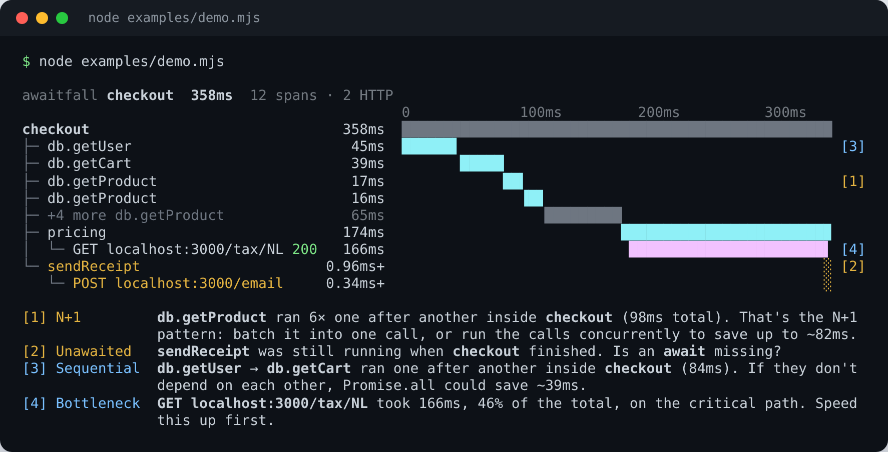

<h1 align="center">awaitfall</h1>

<p align="center">
  <strong>See where your async time goes.</strong><br>
  A waterfall of your <code>await</code>s, right in your terminal, with hints that catch<br>
  N+1 loops, missed <code>Promise.all</code>s and forgotten <code>await</code>s.
</p>

<p align="center">
  <a href="https://www.npmjs.com/package/awaitfall"></a>
  <a href="https://github.com/Daksh-Bole/Npm-package-/actions/workflows/ci.yml"></a>
  
  
  <a href="./LICENSE"></a>
</p>

<p align="center">
  
</p>

```js
import { trace } from 'awaitfall'

await trace('checkout', () => checkout(cartId)) // prints the waterfall above when it finishes
```

That's the whole setup. Outgoing HTTP calls (`fetch`, axios, got, `node:http` and so on) show up on their own. Wrap your own steps in `span()` to see them too.

## Why?

Async code is usually slow because it **waits**, not because it computes. It awaits things one after another that could run together, queries the database in a loop, or sits on one slow API call. The usual tools don't show this well:

| Tool                                          | What you get             | What's missing                                                                  |
| --------------------------------------------- | ------------------------ | ------------------------------------------------------------------------------- |
| `console.time`                                | A flat list of numbers   | Nesting, overlap, and which part actually mattered                              |
| CPU profilers (`--cpu-prof`, 0x, flamegraphs) | Where the CPU is busy    | Time spent _waiting_, which is most of your latency                             |
| OpenTelemetry + Jaeger/Tempo                  | Full distributed tracing | An SDK, exporters, a collector and a UI. Heavy for "why is this function slow?" |
| APM services                                  | Production dashboards    | Something you can use on your laptop in 10 seconds                              |

awaitfall is the 10-second version. Wrap a function, run it, and read the answer in your terminal. It also tells you **what to fix**, not just how long things took.

## What it catches

| Insight        | Example finding                                                                                   | Why it matters                                                                          |
| -------------- | ------------------------------------------------------------------------------------------------- | --------------------------------------------------------------------------------------- |
| **N+1**        | `db.getProduct` ran 6× one after another inside `checkout`                                        | The most common reason a request is slow. Batch or parallelize it.                      |
| **Sequential** | `db.getUser` → `db.getCart` ran one after another… Promise.all could save ~39ms                   | A missed `Promise.all` is free latency.                                                 |
| **Unawaited**  | `sendReceipt` was still running when `checkout` finished. Is an `await` missing?                  | Floating promises cause lost errors, flaky tests and work that silently never finishes. |
| **Bottleneck** | `GET api/tax` took 159ms, 45% of the total, on the critical path                                  | Tells you what to speed up first. Spans off the critical path can't make it faster.     |
| **Error**      | `fetchRates` failed after 3.0ms with Error: ECONNRESET. It was caught before reaching `checkout`. | Swallowed failures, often retries, quietly add latency.                                 |

Hints are phrased as questions when awaitfall can't know for sure. It can't see whether two calls depend on each other, so it says "if they don't depend on each other".

## Install

```bash
npm install awaitfall
```

Works with Node.js 18+, in ESM and CommonJS, with types included and **zero dependencies**.

## Quick start

```js
import { trace, span } from 'awaitfall'

await trace('checkout', async () => {
  const user = await span('loadUser', () => db.users.find(userId))
  const cart = await span('loadCart', () => db.carts.find(userId))
  const rates = await fetch(`https://api.example.com/tax/${user.country}`) // recorded automatically
  return price(cart, await rates.json())
})
```

Here is what that looks like for [`examples/demo.mjs`](./examples/demo.mjs), a small checkout flow with a few classic mistakes in it. Output goes to stderr, in color and sized to your terminal:

```text
awaitfall checkout  353ms  12 spans · 2 HTTP
                                             0             100ms          200ms         300ms
checkout                              353ms  ███████████████████████████████████████████████████
├─ db.getUser                          45ms  ██████▋                                             [3]
├─ db.getCart                          39ms        ▕█████▎
├─ db.getProduct                       16ms              ▐█▌                                     [1]
├─ db.getProduct                       17ms                ▐██
├─ +4 more db.getProduct               65ms                  ▕█████████▍
├─ pricing                            169ms                            ▐███████████████████████▊
│  └─ GET localhost:3000/tax/NL 200   161ms                             ███████████████████████▍ [4]
└─ sendReceipt                       1.3ms+                                                    ░ [2]
   └─ POST localhost:3000/email     0.43ms+                                                    ░

[1] N+1         `db.getProduct` ran 6× one after another inside `checkout` (97ms total). That's the
                N+1 pattern: batch it into one call, or run the calls concurrently to save up to
                ~81ms.
[2] Unawaited   `sendReceipt` was still running when `checkout` finished. Is an `await` missing?
[3] Sequential  `db.getUser` → `db.getCart` ran one after another inside `checkout` (84ms). If they
                don't depend on each other, Promise.all could save ~39ms.
[4] Bottleneck  `GET localhost:3000/tax/NL` took 161ms, 46% of the total, on the critical path.
                Speed this up first.
```

How to read it:

- Bright bars are the **critical path**, the chain of work that set the total time. Dim bars ran in its shadow.
- `+4 more db.getProduct` folds a run of identical siblings into one row, so loops don't flood your terminal.
- `░` and a trailing `+` mean the span was **still running** when the trace ended.
- `[n]` markers point from a bar to the matching finding below.

Try it yourself: clone the repo, then `npm install && npm run build && npm run demo`.

## Ways to instrument

You only need `trace()`. Everything else adds detail.

### `span()`: mark a step

```js
const user = await span('loadUser', () => getUser(id))
```

`span()` returns whatever the function returns, sync or async, and rethrows its errors unchanged. **Outside a trace it just calls the function**, so it's safe to leave in production code.

### `wrap()`: instrument a function once and use it everywhere

```js
import { wrap } from 'awaitfall'

export const getUser = wrap('db.getUser', async (id) => {
  /* ... */
})
```

### `instrument()`: instrument a whole client in one line

```js
import { instrument } from 'awaitfall'
import pg from 'pg'

const db = instrument(new pg.Pool(), 'pg') // every db.query(...) becomes a "pg.query" span
const users = instrument(prisma.user, 'prisma.user') // prisma.user.findMany(...) and friends
```

Only calls that return a promise become spans, so getters, event-emitter methods and builders don't clutter the output. Pass `{ sync: true }` to record synchronous methods too. Private fields and getters keep working.

> Prisma tip: instrument model delegates such as `prisma.user`, not `prisma` itself. Don't pass instrumented queries into `prisma.$transaction([...])`, which expects Prisma's own lazy promises.

### Automatic HTTP capture (Node.js)

Requests made with `fetch`, undici, `node:http`/`node:https`, or anything built on them (axios, got, node-fetch, ky, SDKs) are recorded as `METHOD host/path` with their status code. awaitfall listens to Node's built-in [diagnostics channels](https://nodejs.org/api/diagnostics_channel.html) and **doesn't monkey-patch anything**. Query strings are dropped from names because they often carry tokens. Turn it off with `{ http: false }`.

### Express and Connect: trace every request

```js
import express from 'express'
import { middleware } from 'awaitfall'

const app = express()
app.use(middleware({ threshold: 200 })) // print only requests slower than 200ms
```

### Koa, Hono and other middleware-style frameworks

```js
// Koa
app.use((ctx, next) => trace(`${ctx.method} ${ctx.path}`, () => next(), { threshold: 200 }))

// Hono
app.use((c, next) => trace(`${c.req.method} ${c.req.path}`, () => next(), { threshold: 200 }))
```

### Fastify and other hook-based frameworks

```js
fastify.addHook('onRequest', (req, reply, done) => {
  req.trace = trace.start(`${req.method} ${req.url}`)
  req.trace.run(done) // everything after this hook runs inside the trace
})
fastify.addHook('onResponse', (req, reply, done) => {
  req.trace.end()
  done()
})
```

### Scripts, CLIs and build steps

```js
await trace('build', async () => {
  await span('clean', clean)
  await Promise.all([span('compile', compile), span('copy assets', copyAssets)])
  await span('bundle', bundle)
})
```

## Use it in tests: fail CI on N+1 queries

`profile()` runs a function, returns its result **and** the report, and prints nothing:

```js
import { profile } from 'awaitfall'
import { expect, test } from 'vitest'

test('GET /cart does not query products in a loop', async () => {
  const { result, report } = await profile('GET /cart', () => getCart(userId))

  expect(result.items).toHaveLength(3)
  expect(report.insights.filter((i) => i.kind === 'repeated')).toEqual([])
  expect(report.duration).toBeLessThan(200)
})
```

Reports are plain JSON. Snapshot them, assert on `report.spans`, or save them as CI artifacts.

## Export to Perfetto when the terminal isn't enough

```js
import { writeFileSync } from 'node:fs'
import { trace, toChromeTrace } from 'awaitfall'

await trace('import job', runImport, {
  onEnd: (report) => writeFileSync('trace.json', JSON.stringify(toChromeTrace(report))),
})
// Open trace.json in https://ui.perfetto.dev, chrome://tracing or https://www.speedscope.app
```

## API

### `trace(name?, fn, options?)`

Runs `fn(span)`, records everything it does, and prints a waterfall when it finishes. It returns whatever `fn` returns: a plain value for sync functions and a promise for async ones. If `fn` throws or rejects, the same error is rethrown. If you omit `name`, the function's name is used. Called inside another trace, `trace()` acts like `span()` and doesn't print separately.

### `trace.start(name, options?)` → `ActiveTrace`

For code where one callback can't wrap the whole operation. `active.run(fn)` executes `fn` inside the trace. `active.end(error?)` finishes it, prints it, and returns the `TraceReport`. Calling `end()` again returns the same report. `active.set(key, value)` attaches data to the root span.

### `span(name?, fn)`

Records `fn` as a step of the current trace and returns its result. Outside a trace it just calls `fn`. `fn` receives a `Span` handle:

| Member                 | Description                                                                                         |
| ---------------------- | --------------------------------------------------------------------------------------------------- |
| `span.name`            | The span's name                                                                                     |
| `span.set(key, value)` | Attach a string, number or boolean. It appears in `report.spans[i].attrs` and in Chrome exports.    |
| `span.span(name, fn)`  | Create a child explicitly. This works even where AsyncLocalStorage doesn't exist, such as browsers. |

### `wrap(name?, fn)` → same function type

Returns a function that records a span on every call. `this`, arguments, return values, errors, `name` and `length` are preserved.

### `instrument(object, name | { name?, sync? })` → same object type

Returns a proxy whose methods record `<name>.<method>` spans. `name` defaults to the class name. Use `sync: true` to also record methods that return synchronously.

### `profile(name?, fn, options?)` → `{ result, report }` (or a promise of it)

Like `trace()`, but returns the report instead of printing it (`print` defaults to `false`). It always records, even when tracing is disabled or another trace is active. It's built for tests.

### `middleware(options?)`

Connect/Express middleware that runs each request in a trace and ends it when the response finishes. The root span gets a `status` attribute, and 5xx responses mark the trace as failed. `options.name(req)` customizes the trace name, which defaults to `METHOD /path`.

### `configure(options)`

Sets global defaults for every trace, for example in a test setup file. It **replaces** the previous configuration, and options passed to individual calls take priority. Accepts every `TraceOptions` field plus `enabled: boolean`.

### `render(report, options?)` → `string`

Renders a report as the text waterfall. Useful with `onEnd` or with reports you've stored.

### `toChromeTrace(report)` → `ChromeTrace`

Converts a report to the Chrome Trace Event Format. Concurrent spans are placed on separate lanes so viewers draw them correctly.

### Options

| Option        | Default                       | Description                                                                                                         |
| ------------- | ----------------------------- | ------------------------------------------------------------------------------------------------------------------- |
| `print`       | `true` (`false` in `profile`) | Print the waterfall when the trace ends                                                                             |
| `threshold`   | `0`                           | Only print traces that took at least this many ms                                                                   |
| `write`       | stderr                        | Where printed text goes, e.g. `(text) => logger.debug(text)`                                                        |
| `onEnd`       | —                             | Called with every finished `TraceReport`, whether or not it's printed                                               |
| `http`        | `true`                        | Record outgoing HTTP requests (Node.js)                                                                             |
| `insights`    | `true`                        | `false` turns insights off. An object tunes them (see below).                                                       |
| `maxSpans`    | `10000`                       | Stop recording after this many spans, to bound memory. Later spans are counted in `report.dropped`.                 |
| `color`       | auto                          | ANSI colors. Auto-detection respects `NO_COLOR`, `FORCE_COLOR`, the TTY, and whether you supplied a custom `write`. |
| `width`       | terminal                      | Output width in columns (60–200 when detected, otherwise 100)                                                       |
| `maxRows`     | `100`                         | Maximum span rows to print                                                                                          |
| `maxInsights` | `5`                           | Maximum findings to print (all of them are in `report.insights`)                                                    |
| `fold`        | `3`                           | Fold runs of more than this many identical siblings. `0` turns folding off.                                         |

Insight tuning (`insights: { ... }`):

| Option            | Default | Description                                                                                     |
| ----------------- | ------- | ----------------------------------------------------------------------------------------------- |
| `minRepeats`      | `5`     | Sequential repeats needed to report an N+1. Concurrent repeats need twice as many.              |
| `minSavings`      | `5`     | Minimum estimated savings in ms. The effective floor is the larger of this and 5% of the trace. |
| `bottleneckRatio` | `0.25`  | Share of the total time a span's own time must reach to be called the bottleneck                |
| `ignore`          | `[]`    | Kinds to skip: `'sequential' \| 'repeated' \| 'unawaited' \| 'bottleneck' \| 'error'`           |

### The report

```ts
interface TraceReport {
  name: string
  startedAt: number // epoch ms
  duration: number // ms
  status: 'ok' | 'error'
  spans: SpanData[] // start order, spans[0] is the root
  insights: Insight[] // warnings first
  dropped: number
}

interface SpanData {
  id: number
  parentId: number | null
  name: string
  kind: 'trace' | 'span' | 'http'
  start: number // ms since the trace started
  end: number | null // null = still running when the trace ended
  duration: number
  selfTime: number // time not covered by child spans
  status: 'ok' | 'error' | 'running'
  async: boolean
  error?: string // "TypeError: message"
  attrs: Record<string, string | number | boolean> // e.g. { status: 200 } on HTTP spans
  depth: number
  critical: boolean // on the critical path
}

interface Insight {
  kind: 'sequential' | 'repeated' | 'unawaited' | 'bottleneck' | 'error'
  severity: 'warn' | 'info'
  message: string // span names in `backticks`
  spanIds: number[]
  savings?: number // estimated ms
}
```

## TypeScript

Types ship with the package, and return types follow your function:

```ts
import { trace, span, type TraceReport } from 'awaitfall'

const total: number = trace('sum', () => 1 + 1) // sync stays sync
const user: Promise<User> = trace('load', () => getUser(id)) // async stays async
const report: TraceReport | undefined = trace.start('job').end()
```

## Errors and guarantees

- **awaitfall never changes what your code does.** Return values, thrown errors (the same object), and sync-versus-async behavior pass through untouched.
- **Failures inside awaitfall never reach your code.** If your `onEnd` or `write` throws, you get an `[awaitfall] …` line on stderr instead. Problems inspecting an HTTP request are ignored, and the request goes ahead untouched.
- **Wrong arguments fail fast with a fix.** For example, `span('load', getUser(id))` throws `TypeError: [awaitfall] span(name, fn) expects a function as the second argument, got a promise. Did you mean span('load', () => yourCall())?`
- Spans created after their trace ended are ignored, and work that outlived the trace is reported as `unawaited`.

## Production use

- `span()`, `wrap()` and `instrument()` just call through when no trace is active. On Node 22 the cost was about 4–20 ns per call on the machine used for these measurements.
- Set `AWAITFALL=0` (or `false`/`off`), or call `configure({ enabled: false })`, to make `trace()` and `middleware()` call through as well.
- For production investigations, prefer `threshold` plus a custom `write` or `onEnd` that sends slow traces to your logger.

## Performance

Measured on Node 22 on the machine used to develop the package, so treat these as rough numbers:

| Operation                                   | Cost                                                    |
| ------------------------------------------- | ------------------------------------------------------- |
| `span()` outside a trace                    | ~4 ns (sync) / ~20 ns (async) on top of the call itself |
| Recorded sync span                          | ~1 µs                                                   |
| Recorded async span                         | ~1.5 µs                                                 |
| Analyzing and rendering a 10,000-span trace | ~45 ms to run and analyze, ~16 ms to render             |

Memory grows with the number of recorded spans (one small object each), bounded by `maxSpans`. HTTP capture costs one AsyncLocalStorage lookup per request, and requests made outside a trace are ignored.

## Compatibility

| Runtime                                                              | Status                                                                                                             |
| -------------------------------------------------------------------- | ------------------------------------------------------------------------------------------------------------------ |
| Node.js 18, 20, 22, 24                                               | ✅ Tested (unit tests on 22 and 24 in CI; smoke tests on 18 and 20)                                                |
| Bun, Deno                                                            | Should work through the `node` export condition, but not tested yet. Reports are welcome.                          |
| Edge runtimes (Vercel Edge, Cloudflare Workers with `nodejs_compat`) | Implicit context works where `AsyncLocalStorage` is available. HTTP capture is Node-only.                          |
| Browsers                                                             | Explicit handles only (`trace('x', async (t) => t.span('y', fn))`), because browsers have no AsyncLocalStorage yet |

## How it works

1. `trace()` creates a root span and runs your function inside an [`AsyncLocalStorage`](https://nodejs.org/api/async_context.html) context, so every `span()` call knows its parent, even across `await`s and `Promise.all`.
2. HTTP clients publish to `diagnostics_channel`. awaitfall subscribes once and turns requests into child spans of whatever span is current.
3. When the root finishes, the report is built and analyzed. Analysis computes self time, the critical path, repeated and overlapping sibling groups, and spans that outlived their parents. Then the waterfall is drawn with Unicode block characters at 1/8-cell precision.

## FAQ

**Is this a replacement for OpenTelemetry?** No. OpenTelemetry is for production observability across services. awaitfall is for the question you have _right now_ on your machine or in CI. The two can coexist.

**Does it slow my app down?** Not noticeably. See [Performance](#performance). Outside a trace it does almost nothing.

**Why does it say "If they don't depend on each other"?** Because it can't know. Runtime tracing sees timing, not data flow. Ignore the hint when the second call needs the first one's result, or turn it off with `insights: { ignore: ['sequential'] }`.

**Why stderr?** So piping your program's stdout (JSON, CSV, …) keeps working. Use `write` to send the output somewhere else.

## Roadmap

- `npx awaitfall your-script.js`: trace a whole script with no code changes.
- Database driver hooks through diagnostics channels as drivers adopt them (`pg`, `mysql2`, `ioredis`), so queries show up the way HTTP does.
- Bun and Deno in CI.
- An HTML report (a self-contained file you can attach to a pull request).
- A Vitest/Jest reporter that prints the waterfall of slow tests.
- Optional per-span stack locations, to jump from a bar straight to the code.

Ideas and votes are welcome in [issues](https://github.com/Daksh-Bole/Npm-package-/issues).

## Contributing

Bug reports, ideas and pull requests are welcome. See [CONTRIBUTING.md](./CONTRIBUTING.md) for setup, architecture notes and good first issues.

## License

[MIT](./LICENSE)
